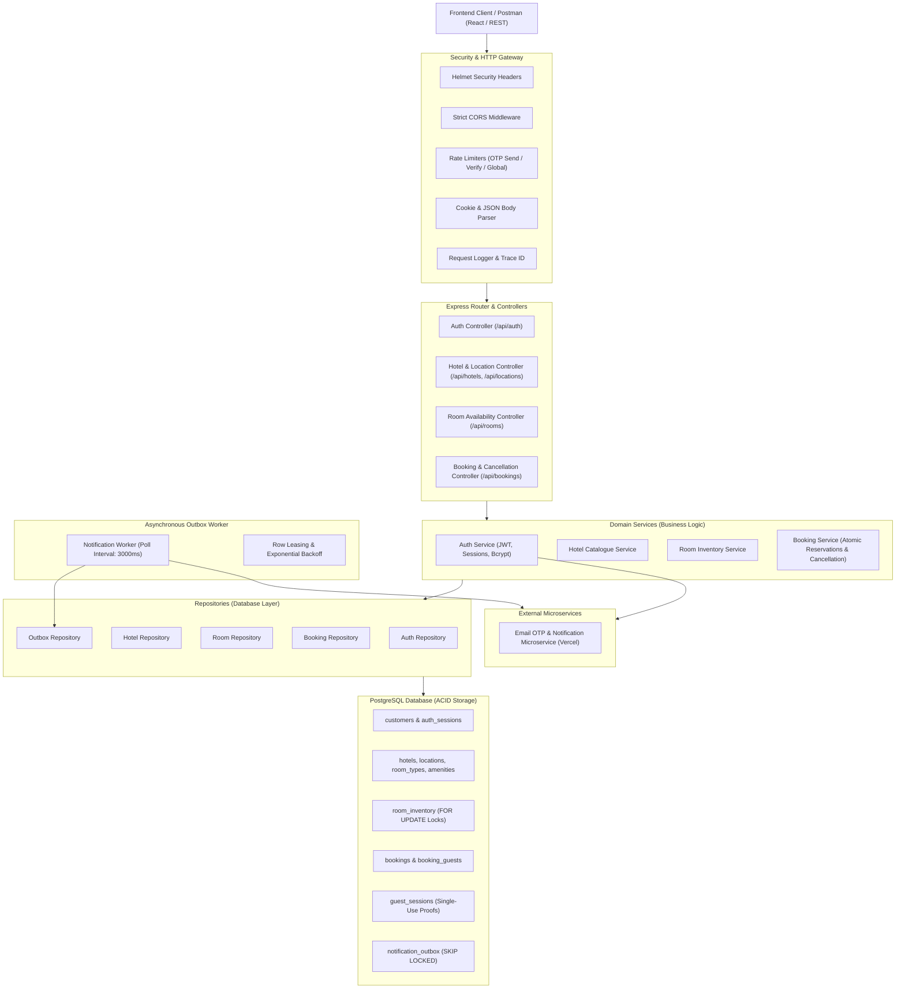
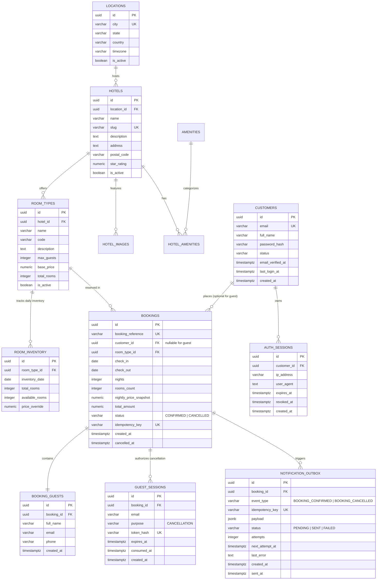

# Hotel Booking Portal — System Design Document (DESIGN.md)

This document provides a comprehensive technical reference for the architecture, database schema, concurrency controls, security safeguards, and asynchronous notification worker of the Hotel Booking Portal backend.

> [!NOTE]
> **Deployment Status:**
> This system is developed, verified, and configured for **local Node.js (v20+) and PostgreSQL (v15+)**. No production cloud deployment (e.g. AWS/GCP/Vercel serverless) has been performed yet for the backend server.

---

## 1. System Architecture

The backend follows a layered, domain-driven modular architecture designed for high maintainability, strict transaction boundaries, and horizontal scalability.

---

## 2. Database Schema & Entity Relationships

---

## 3. Concurrency, Invariants & Security Architecture

1. **Room Inventory Concurrency:**
   - Evaluated within strict database transactions (`BEGIN ... COMMIT ... ROLLBACK`).
   - Row-level locking on `room_inventory` with deterministic sorting:
     `SELECT available_rooms FROM room_inventory WHERE ... ORDER BY inventory_date ASC FOR UPDATE`
   - Zero overbooking and zero partial reservations across multi-night stays.
2. **Stay Interval Semantics:**
   - Check-in is **inclusive**, checkout is **exclusive** ($[checkIn, checkOut)$). The checkout date never consumes room inventory.
3. **Decoupled Transactional Outbox:**
   - Events are staged in `notification_outbox` inside the booking transaction.
   - Separate worker polls using `FOR UPDATE SKIP LOCKED` and leases records.
   - Exponential backoff with jitter on transient failures.
4. **Defense in Depth Security:**
   - Anti-enumeration generic 404 on booking lookup.
   - HttpOnly, SameSite, Secure session cookies.
   - Strict CSRF protection with cryptographic token verification.
   - All SQL parameterized; inputs strongly validated via Zod.
