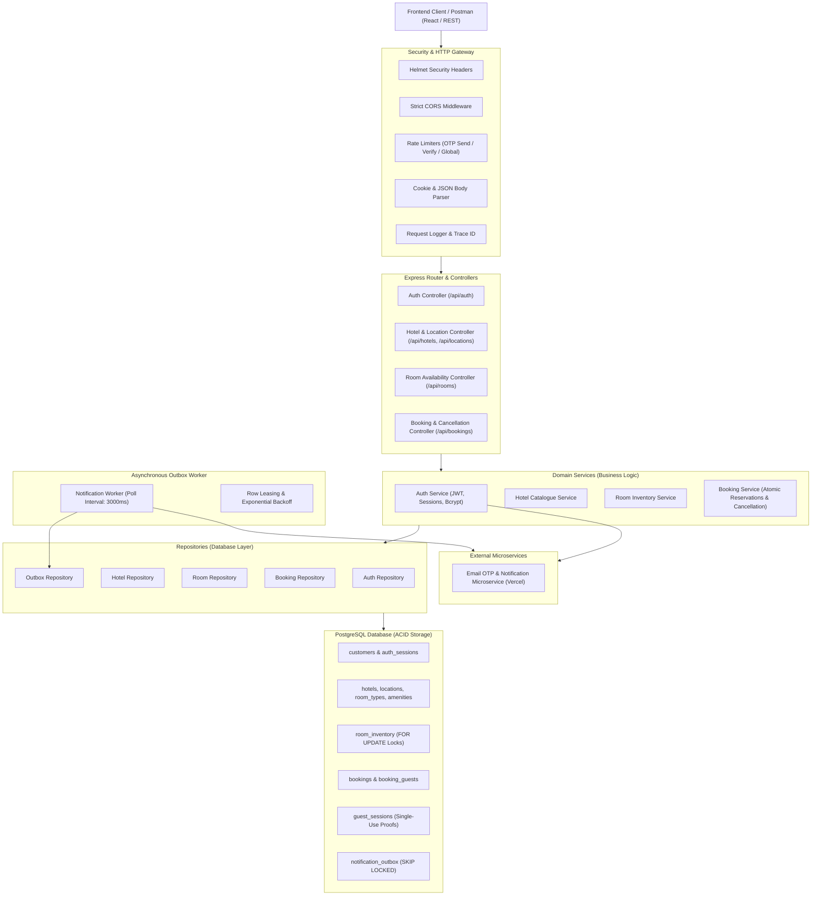
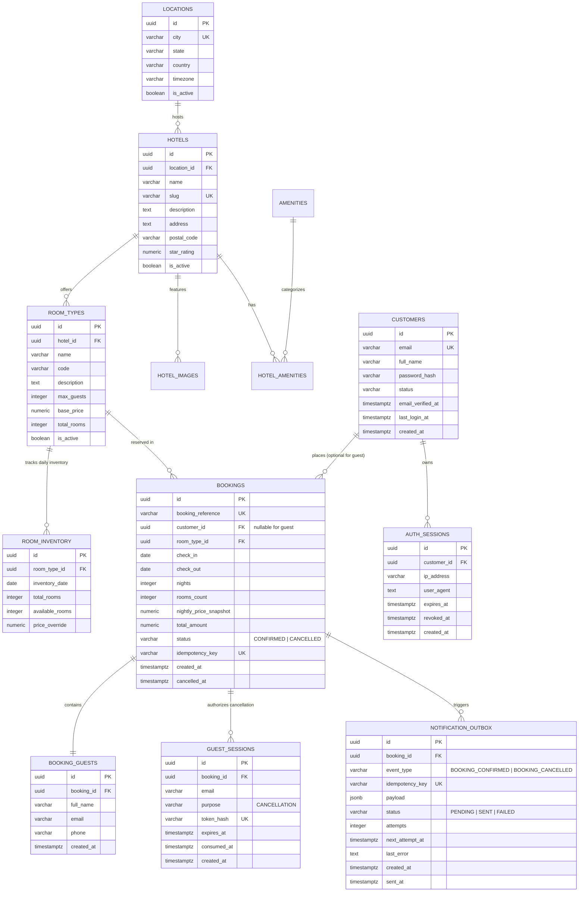

# Hotel Booking Portal — System Design Document (DESIGN.md)

This document provides a comprehensive technical reference for the architecture, database schema, concurrency controls, security safeguards, and asynchronous notification worker of the Hotel Booking Portal backend.

> [!NOTE]
> **Deployment Status:**
> This system is developed, verified, and configured for **local Node.js (v20+) and PostgreSQL (v15+)**. No production cloud deployment (e.g. AWS/GCP/Vercel serverless) has been performed yet for the backend server.

---

## 1. System Architecture

The backend follows a layered, domain-driven modular architecture designed for high maintainability, strict transaction boundaries, and horizontal scalability.



---

## 2. Database Schema & Entity Relationships



---

## 3. Concurrency, Invariants & Security Architecture

1. **Room Inventory Concurrency:**
   - Evaluated within strict database transactions (`BEGIN ... COMMIT ... ROLLBACK`).
   - Row-level locking on `room_inventory` with deterministic sorting:
     `SELECT available_rooms FROM room_inventory WHERE ... ORDER BY inventory_date ASC FOR UPDATE`
   - Zero overbooking and zero partial reservations across multi-night stays.
2. **Stay Interval Semantics:**
   - Check-in is **inclusive**, checkout is **exclusive** ($[checkIn, checkOut)$). The checkout date never consumes room inventory.
3. **Decoupled Transactional Outbox:**
   - Events are staged in `notification_outbox` inside the booking transaction.
   - Separate worker polls using `FOR UPDATE SKIP LOCKED` and leases records.
   - Exponential backoff with jitter on transient failures.
4. **Defense in Depth Security:**
   - Anti-enumeration generic 404 on booking lookup.
   - HttpOnly, SameSite, Secure session cookies.
   - Strict CSRF protection with cryptographic token verification.
   - All SQL parameterized; inputs strongly validated via Zod.

---

## 4. Frontend Architecture & Modern Luxury Hospitality Design System

### 4.1 Technology Stack

| Category | Library / Specification | Purpose |
| :--- | :--- | :--- |
| **Core Framework** | React 18+ (JavaScript ES6+) | SPA architecture, modular component hierarchy |
| **Build Tool** | Vite | Instant HMR, optimized production bundling |
| **Styling** | Tailwind CSS | Utility-first styling configured with design tokens |
| **State Management** | Redux Toolkit (RTK) | Client UI state (`authSlice`, `bookingSlice`, `uiSlice`) + RTK Query / Axios |
| **HTTP Client** | Axios | Centralized client with `withCredentials: true`, CSRF interceptors |
| **Form Validation** | React Hook Form + Zod | Schema-driven client validation matching backend contracts |
| **Iconography** | `react-icons` & `lucide-react` | Semantic, elegant stroke icons for amenities and navigation |
| **Skeleton Loading** | `react-loading-skeleton` | Atmospheric, content-shaped loading states |
| **Spinners / Loaders** | `react-loader-spinner` | Elegant low-velocity spinners for actions and submissions |

### 4.2 Modern Luxury Hospitality Theme (Design Tokens)

#### Color Palette
```yaml
colors:
  surface: '#fcf9f4'                  # Warm Ivory base canvas
  surface-dim: '#dcdad5'              # Recessed canvas
  surface-bright: '#fcf9f4'           # Luminous surface
  surface-container-lowest: '#ffffff' # Pure White (cards, modals)
  surface-container-low: '#f6f3ee'    # Subdued container
  surface-container: '#f0ede8'        # Standard container
  surface-container-high: '#ebe8e3'   # Elevated container
  surface-container-highest: '#e5e2dd'# Sand border / divider tint
  on-surface: '#1c1c19'               # Deep Charcoal text
  on-surface-variant: '#4e453a'       # Warm Charcoal secondary text
  inverse-surface: '#31302d'
  inverse-on-surface: '#f3f0eb'
  outline: '#807569'                  # Medium hairline outline
  outline-variant: '#d1c5b6'          # Soft hairline divider / border
  surface-tint: '#775928'             # Deep Antique Gold tint
  primary: '#775928'                  # Deep Antique Gold
  on-primary: '#ffffff'
  primary-container: '#b08d57'        # Champagne Gold accent
  on-primary-container: '#3d2700'
  inverse-primary: '#e8c086'
  secondary: '#625e55'                # Warm Slate / Grey
  on-secondary: '#ffffff'
  secondary-container: '#e6dfd3'      # Sand highlight
  on-secondary-container: '#666259'
  tertiary: '#496080'                 # Muted Deep Slate / Blue
  on-tertiary: '#ffffff'
  tertiary-container: '#7d94b7'
  on-tertiary-container: '#132c4a'
  error: '#ba1a1a'                    # Terracotta Red for alerts
  on-error: '#ffffff'
  error-container: '#ffdad6'
  on-error-container: '#93000a'
  background: '#fcf9f4'
  on-background: '#1c1c19'
```

#### Typography Hierarchy
- **Editorial Display & Headlines (`Playfair Display`, serif):**
  - `display`: 56px / Line Height: 64px / Letter Spacing: -0.02em / Weight: 400
  - `display-mobile`: 38px / Line Height: 46px / Letter Spacing: -0.01em / Weight: 400
  - `headline-lg`: 40px / Line Height: 48px / Letter Spacing: -0.015em / Weight: 400
  - `headline-lg-mobile`: 30px / Line Height: 38px / Letter Spacing: 0em / Weight: 400
  - `headline-md`: 28px / Line Height: 36px / Weight: 500
  - `headline-sm`: 22px / Line Height: 30px / Weight: 500
- **Functional Body & Labels (`Inter`, sans-serif):**
  - `body-lg`: 18px / Line Height: 28px / Letter Spacing: -0.005em / Weight: 300
  - `body-md`: 15px / Line Height: 24px / Weight: 400
  - `body-sm`: 13px / Line Height: 20px / Weight: 400
  - `label-md`: 12px / Line Height: 16px / Letter Spacing: 0.08em (uppercase) / Weight: 500
  - `label-sm`: 11px / Line Height: 14px / Letter Spacing: 0.10em (uppercase) / Weight: 600

#### Geometry & Elevation
- **Corner Radii (Soft Level 1):**
  - Cards, inputs, containers: `rounded` (`0.25rem` / `4px`).
  - Subtle soft elements (modals, sheets): `rounded-lg` (`0.5rem` / `8px`).
  - Feature chips / tags: `rounded-sm` (`0.125rem` / `2px`).
  - Circular elements: `rounded-full` strictly reserved for initials and play dials.
- **Depth & Shadows:**
  - Avoid heavy SaaS drop shadows. Depth is achieved via tonal stratification (`#fcf9f4` base, `#f0ede8` recessed, `#ffffff` elevated).
  - Warm architectural shadow: `box-shadow: 0 12px 32px -4px rgba(37, 35, 34, 0.05), 0 4px 12px -2px rgba(37, 35, 34, 0.03)`.
  - Frosted glass headers: `background: rgba(252, 249, 244, 0.88); backdrop-filter: blur(12px)`.

### 4.3 UI Component Rules

1. **Buttons & CTAs:**
   - **Primary:** Deep Charcoal (`#1c1c19`) fill, Warm Ivory text (`#fcf9f4`), 1px border. Padding: 14px 28px. Font: `label-md` uppercase tracked. Hover transitions smoothly (300ms) to Champagne Gold (`#b08d57`) with pure white text.
   - **Secondary / Ghost:** Transparent background, 1px Champagne Gold border, Charcoal text. Hover reveals soft Sand tint (`#f0ede8`).
2. **Property & Room Cards:**
   - Pure White surface (`#ffffff`), 1px Sand hairline border (`#e5e2dd`), 4px radius.
   - Architectural image with subtle 1.02x scale zoom on hover (600ms transition).
   - Uppercase category badge, Playfair Display title, Inter specifications, right-aligned nightly price.
3. **Input Fields & Forms:**
   - Pure white surface, 1px border (`#d1c5b6`), Charcoal text, Warm Grey placeholder (`#807569`). Focus state: 1px Champagne Gold (`#b08d57`) border with zero browser ring.
4. **Loaders & Skeletons:**
   - Content-shaped skeletons using `react-loading-skeleton` styled with warm ivory base and sand highlight (`baseColor="#f0ede8"` and `highlightColor="#fcf9f4"`).
   - Action buttons & modals use `react-loader-spinner` (`TailSpin` or `Oval` in `#b08d57` Champagne Gold or `#1c1c19` Charcoal).

### 4.4 Mandatory Pre-Page Creation Verification Protocol

Before creating any screen or component, the implementation MUST be verified against this checklist:
- [ ] **Palette Conformance:** Backgrounds strictly `#fcf9f4` / containers `#ffffff`; borders `#e5e2dd` or `#d1c5b6`; accents `#b08d57`.
- [ ] **Typography Hierarchy:** Headings use `Playfair Display`; body and inputs use `Inter`; badges use tracked uppercase `label-md` or `label-sm`.
- [ ] **Geometry Integrity:** Corner radii maintain `rounded` (4px); no pill-shaped buttons.
- [ ] **Feedback States:** Skeletons via `react-loading-skeleton` and spinners via `react-loader-spinner` incorporated for all asynchronous actions.
- [ ] **Backend Invariant Check:** Respect single-room rule (1 room per booking), server-authoritative pricing, zero token storage, and guest checkout isolation.
