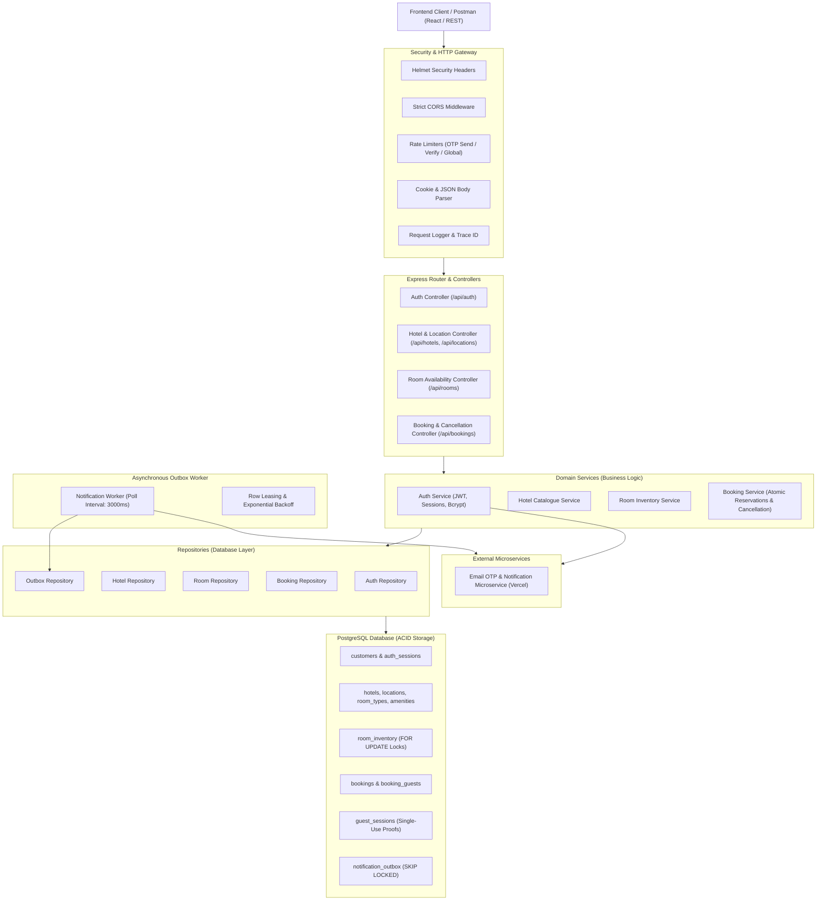
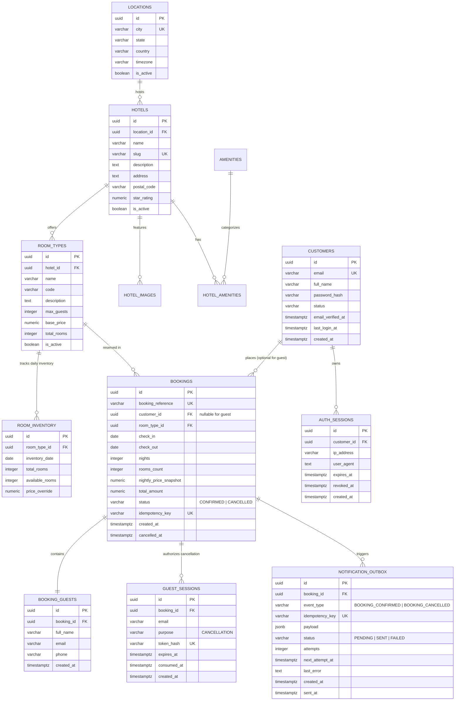
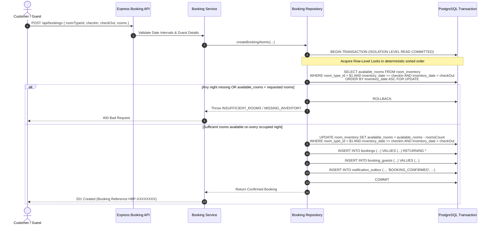
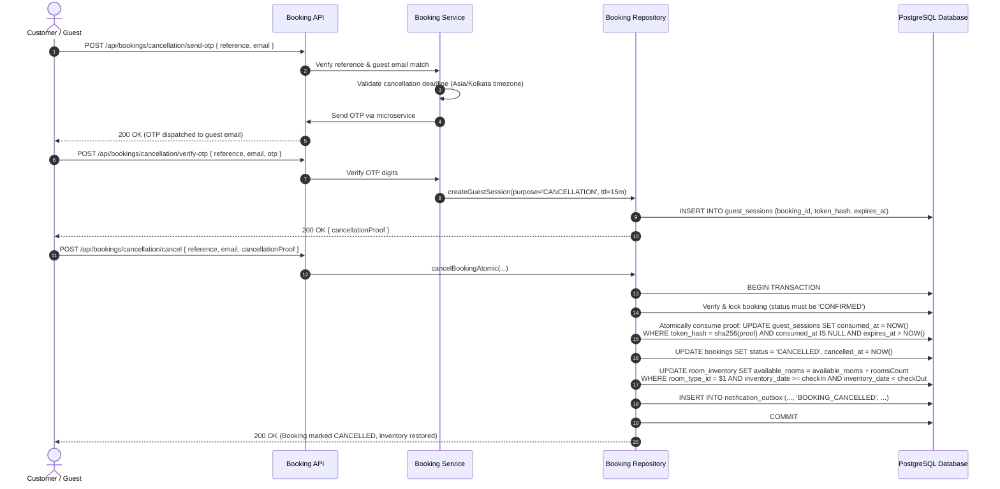
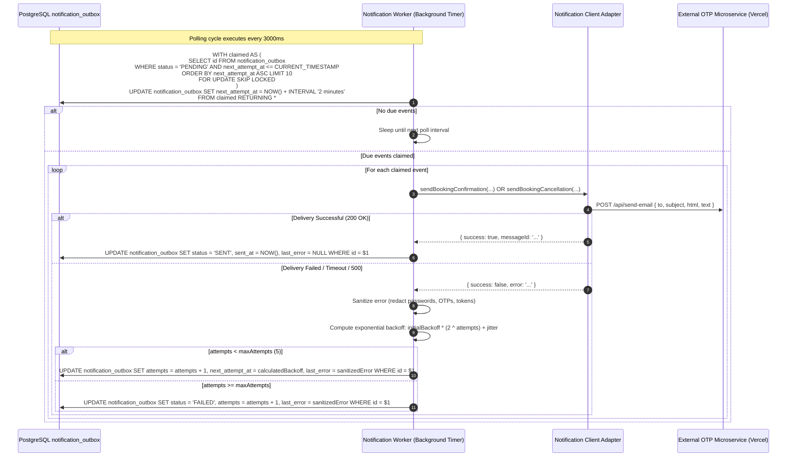

# Hotel Booking Portal — System Design Document (DESIGN.md)

This document provides a comprehensive technical reference for the architecture, database schema, concurrency controls, security safeguards, and asynchronous notification worker of the Hotel Booking Portal backend.

> [!NOTE]
> **Deployment Status:**
> This system is developed, verified, and configured for **local Node.js (v20+) and PostgreSQL (v15+)**. No production cloud deployment (e.g. AWS/GCP/Vercel serverless) has been performed yet for the backend server.

---

## 1. System Architecture

The backend follows a layered, domain-driven modular architecture designed for high maintainability, strict transaction boundaries, and horizontal scalability.



---

## 2. Database Schema & Entity Relationships



---

## 3. Module Responsibilities & Directory Layout

```
server/
├── postman/                             # Exported Postman collections
│   ├── Hotel_Booking_Portal_Complete.postman_collection.json # Unified Master Collection
│   └── README.md                        # Postman execution guide
├── src/
│   ├── config/
│   │   └── env.js                       # Environment validation & configuration
│   ├── constants/
│   │   └── errorMessages.js             # Standardized error codes & messages
│   ├── controllers/
│   │   ├── booking.controller.js        # Booking, lookup, history, cancellation endpoints
│   │   ├── hotel.controller.js          # Hotel catalogue & search endpoints
│   │   ├── location.controller.js       # Geographic locations endpoints
│   │   ├── room.controller.js           # Room categories & availability endpoints
│   │   └── amenity.controller.js        # Hotel amenities endpoints
│   ├── database/
│   │   ├── connection.js                # PostgreSQL connection pool & health checks
│   │   ├── migrations/                  # 001 to 007 SQL schema migration files
│   │   └── seeds/                       # 100 hotel fictional seed generator
│   ├── integrations/
│   │   ├── notification/
│   │   │   └── notification.client.js   # Microservice email notification adapter
│   │   └── otp/
│   │       └── otpClient.js             # Microservice OTP verification client
│   ├── middleware/
│   │   ├── error.middleware.js          # Centralized error handler & AppError
│   │   ├── notFound.middleware.js       # 404 handler
│   │   ├── rateLimiter.middleware.js    # Rate limiting for OTP & auth
│   │   ├── requestLogger.middleware.js  # Request tracing & logging
│   │   └── validate.middleware.js       # Zod request validator
│   ├── modules/
│   │   └── auth/                        # Customer authentication module
│   │       ├── auth.controller.js       # OTP & Password auth controllers
│   │       ├── auth.middleware.js       # JWT & session verification middleware
│   │       ├── auth.repository.js       # Customer & session database access
│   │       ├── auth.routes.js           # /api/auth routes
│   │       ├── auth.service.js          # Passwordless & credential business logic
│   │       └── auth.validator.js        # Zod auth schemas
│   ├── repositories/
│   │   ├── booking.repository.js        # Transactional booking & inventory queries
│   │   ├── hotel.repository.js          # Parametric hotel listing & detail queries
│   │   ├── location.repository.js       # Location queries with active hotel counts
│   │   ├── outbox.repository.js         # Row-locked SKIP LOCKED outbox access
│   │   └── room.repository.js           # Room availability & CTE inventory queries
│   ├── routes/
│   │   └── index.js                     # Central API route router (/api & /api/v1)
│   ├── services/
│   │   ├── booking.service.js           # Booking orchestration & pricing validation
│   │   ├── hotel.service.js             # Catalogue filtering & sorting logic
│   │   └── notification.service.js      # Notification facade
│   ├── utils/
│   │   ├── apiResponse.js               # Standardized success/error JSON response builders
│   │   ├── dateUtils.js                 # ISO date intervals & timezone cutoff calculations
│   │   ├── generateBookingReference.js  # HBP-XXXXXXXX collision-resistant reference generator
│   │   └── jwt.js                       # Cryptographic JWT signing & verification
│   ├── validators/                      # Zod validation schemas for all routes
│   ├── workers/
│   │   └── notification.worker.js       # Background transactional outbox poller
│   ├── app.js                           # Express app initialization
│   └── server.js                        # HTTP server entrypoint & graceful shutdown
└── tests/                               # 125 automated unit & integration tests
```

---

## 4. Key Architectural & Concurrency Designs

### 4.1 Room Inventory Concurrency Strategy



**Key Concurrency Invariants:**
1. **Row-Level Locking:** Acquiring locks with `ORDER BY inventory_date ASC FOR UPDATE` prevents deadlocks between concurrent multi-room transactions that target overlapping date windows.
2. **Deterministic Stay Interval:** Stay check-in is **inclusive** and checkout is **exclusive** ($[checkIn, checkOut)$). Checkout date never consumes inventory.
3. **Multi-Room Atomicity:** If a user requests 3 rooms, all stay dates must have $\ge 3$ available rooms. If any single night has 2 rooms, the entire reservation aborts with zero partial allocation.
4. **Zero Overbooking Guarantee:** Tested under parallel concurrency workloads with multiple simultaneous workers and customers.

---

### 4.2 Booking Cancellation & Inventory Restoration Strategy



**Security Invariants:**
- **Single-Use Scoped Proof:** Proof token is bound strictly to `booking_id` and `purpose = 'CANCELLATION'`. Proof for Booking A cannot cancel Booking B.
- **Proof Replay Prevention:** Once consumed, any repeated cancellation attempt fails immediately with `400 INVALID_CANCELLATION_PROOF`.
- **Cancellation Cutoff Deadline:** Cancellations are rejected with `400 CANCELLATION_DEADLINE_PASSED` if the current date is on or after the stay's check-in date in the hotel's local timezone.

---

### 4.3 Transactional Notification Outbox & Worker Pattern



---

## 5. Security & Protection Model

| Threat / Vulnerability | Mitigation Mechanism in Backend |
| :--- | :--- |
| **Cross-Site Scripting (XSS)** | JWT stored solely in `HttpOnly`, `SameSite` cookies inaccessible to JavaScript. Helmet sets strict security headers. |
| **Cross-Site Request Forgery (CSRF)** | State-changing authenticated requests enforce an explicit, cryptographic `x-csrf-token` header check. |
| **SQL Injection** | Strict parameterization on all queries (`$1, $2`). Zod strongly validates and sanitizes input before repository access. |
| **IDOR / Identity Spoofing** | Registered `customer_id` is derived strictly from verified JWT session context. Supplying `customerId` in request bodies or query strings is rejected with `400 VALIDATION_ERROR`. |
| **Booking Reference Enumeration** | `POST /api/bookings/lookup` requires both `bookingReference` and `email`. If either is mismatched, returns generic `404 BOOKING_NOT_FOUND` without leaking validity. |
| **OTP Brute-Forcing & DoS** | IP- and email-based rate limiters limit OTP requests to 5 per 15-minute window with 429 status codes. |
| **Sensitive Data Exposure** | Production error handler strips stack traces and internal errors. Notification error sanitizer redacts OTPs, tokens, and passwords. |
| **Double Spend / Overbooking** | Row-level locking on inventory records (`ORDER BY inventory_date ASC FOR UPDATE`) within ACID transactions. |
